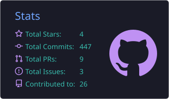
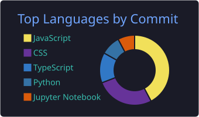

**3rd-year Computer Science student (Cybersecurity) · Full-Stack Developer · Nyeri, Kenya**

---

## 👋 About Me

I'm a full-stack developer who turns simple ideas into fast, usable software, from the interface to the backend. I'm studying Computer Science at DeKUT with a focus on cybersecurity, and I build web apps, Android apps and M-Pesa payment flows for real users and local businesses.

- 🔭 **Focus:** Full-stack development, M-Pesa integration, AI-powered features and cybersecurity
- 🎓 **Studying:** B.Sc. Computer Science, Dedan Kimathi University of Technology (expected 2028)
- 💼 **Open to:** internships and entry-level roles, freelance projects for SMEs, and collaboration on web, mobile and AI products
- 🎬 **Also:** video editing, photography and graphic design
- ⚡ **Outside code:** EndeavourOS tinkering, pool, and *One Piece*

---

## 🚀 Featured Projects

| Project | What it does | Stack |
| :--- | :--- | :--- |
| **[EventSimplified](https://dev.d23xomau6ts39y.amplifyapp.com/dashboard/tasks?event=96a91e24-5aae-498b-8193-ad4612d7fdaa)** | Event planning dashboard with task tracking and AI-powered features. Built with a team and delivered by sprint. | React, Node.js, AWS Amplify |
| **[StudentRegistrationApp](https://unit-registration.vercel.app/login)** | Offline-first student registration (web and Android) that syncs when online, with direct M-Pesa till payment. | Android, SQLite, Firebase, M-Pesa |
| **DeKUT Online Voting System** | Secure campus elections platform: relational schemas, REST API backend, Cisco Packet Tracer network topology and a Figma prototype. *Case study* | MySQL, REST API, Cisco Packet Tracer, Figma |
| **Money Track** | Android expense tracker with custom charts for spending and screen-time habits. *Case study* | Kotlin, Jetpack Compose, Firebase |
| **[Cafe Hub](https://mycafe-hub-qog6.onrender.com)** | Cafe ordering and menu web app with a responsive experience. | React, Node.js |
| **[Learning Management System](https://lms1-black.vercel.app)** | Learning platform covering course and learner flows. | React, Node.js |
| **[Blog Platform](https://blog-app-b0un.onrender.com)** | Publishing platform with posts and a MongoDB-backed API. | React, Node.js, MongoDB |
| **[M-PESA App Redesign](https://www.figma.com/proto/h7Wb7LD0OaPVFqUAldTeiN/M-PESA-APP-DESIGN?node-id=0-1&t=DN3HSAyOZiowtdwq-1)** | Interactive Figma prototype focused on clear payment flows. *Prototype* | Figma, UI/UX |
| **Intelligent Healthcare Diagnostic Assistant** | AI capstone framework with a diagnostic workflow and automated medical report generation. *Case study* | AI, prompt workflows |

More work, case studies and articles on **[my portfolio](https://iamfranklin.vercel.app/)**.

---

## 🧰 Services

| Service | Includes |
| :--- | :--- |
| **Starter SME Web Suite** | 3-page responsive site, Google Business Profile setup, WhatsApp ordering, delivery in 3 days |
| **M-Pesa & E-Commerce Integration** | STK Push callbacks, dynamic catalog or menu, till integration, database setup |
| **Custom AI & Full-Stack Systems** | React / Next.js / Node.js apps, MySQL or MongoDB architecture, AI chatbot workflows, admin dashboard |

Pricing and a live estimator are on the [portfolio](https://iamfranklin.vercel.app/#pricing).

---

## 🛠️ Tech Stack

**Web** &nbsp;

**Mobile** &nbsp;

**Data & Networks** &nbsp;

**Design & Creative** &nbsp;

---

## 🎓 Education & Experience

**Dedan Kimathi University of Technology** *(Jul 2024 – Present · expected 2028)* 
└─ B.Sc. Computer Science, specializing in cybersecurity. Coursework across AI, theory of computing and systems development.

**Internal Attachment, DeKUT Online Voting System** *(DeKUT)* 
└─ MySQL schemas and REST API backend, Cisco Packet Tracer secure campus topology, Figma prototypes for campus elections.

**Full-Stack Developer Apprenticeship, DirectEd Development Foundation** *(Apr 2024 – Aug 2024)* 
└─ Built full-stack apps with React, Next.js and Node.js. Completed with distinction (2nd runner-up) and shipped team projects including EventSimplified.

---

## 📜 Certifications

| Certification | Issuer |
| :--- | :--- |
| [Foundations of Full Stack Web Development](https://www.linkedin.com/in/franklinmuriithi/overlay/Certifications/1067782958/treasury/?profileId=ACoAAErYlasBS0Miglg3sqLCcqbsXemY4KijOXw) | DirectEd Development Foundation |
| [Introduction to Cybersecurity](https://www.credly.com/badges/462ecab7-d995-44f5-9738-8b1083b00f65/linked_in_profile) | Cisco Networking Academy |
| [Data Analytics Training (Power BI & Excel)](https://training.smartacademy.go.ke/certificate-verification/?certificate_id=ICTA-1784709308-7855-44620) | ICT Authority (Kenya) & Sigma Digital |
| [Artificial Intelligence Training](https://training.smartacademy.go.ke/certificate-verification/?certificate_id=ICTA-1783345685-7426-44620) | ICT Authority (Kenya) & Pathways Technologies |
| [AI Essentials for Professionals](https://moringa.my.salesforce-sites.com/certificateStatus?id=a0PQ200000XHXxpMAH) | Moringa School |
| [Certified AI Talent (Outstanding Performance)](https://www.linkedin.com/in/franklinmuriithi/overlay/Certifications/1030780073/treasury/?profileId=ACoAAErYlasBS0Miglg3sqLCcqbsXemY4KijOXw) | micro1 |
| [Design Fundamentals with AI](https://www.coursera.org/account/accomplishments/verify/16UYUQUK6O1U) | Adobe |
| [Create and Design Digital Products](https://www.coursera.org/account/accomplishments/verify/2FP7N3QT6X9C) | Canva / Coursera |
| [In-Depth CapCut Video Editing Masterclass](https://www.coursera.org/account/accomplishments/verify/68F3V1BIXAJD) | Skillshare |

---

## 💬 What People Say

> *"Franklin was a standout talent in our full-stack development program. He consistently demonstrated a deep understanding of modern web technologies and an ability to solve complex engineering problems. A highly dedicated developer."*
> — **Simon Sällström**, CEO, DirectEd Development

> *"Collaborating with Franklin on the EventSimplified project was seamless. He has a rare ability to translate my Figma designs into pixel-perfect code without losing the details. A reliable teammate who communicates clearly."*
> — **Bernard Ngungi**, UI/UX Designer

> *"Integrating Generative AI models into a full-stack app is difficult, but Franklin made it seamless. He handled the backend API logic and frontend rendering perfectly during our group assessments. A technically gifted teammate."*
> — **Vincent Kingatua**, Generative AI Engineer

More testimonials

> *"On the Event Simplified project, I needed a developer who could handle complex AI data streams. Franklin seamlessly integrated my Gen AI models into the application core, ensuring the features were fast, responsive, and scalable."*
> — **Michael Moses**, Gen AI Engineer

> *"Managing the development roadmap for Event Simplified was a challenge, but Franklin made it easier. He took ownership of critical features, consistently hit sprint goals, and communicated technical blockers clearly. A dependable engineering partner."*
> — **Kidus Elias**, Project Manager

---

## 📊 GitHub Stats

<!-- Generated daily by .github/workflows/profile-summary-cards.yml and stored in this repo. -->

---

📫 **Let's talk:** [Email](mailto:franklinmuriithi431@gmail.com) · [WhatsApp](https://wa.me/254716205591) · [LinkedIn](https://www.linkedin.com/in/franklinmuriithi/) · [X](https://x.com/mfrank_lin) · [YouTube](https://www.youtube.com/@voidr3am) · [Portfolio](https://iamfranklin.vercel.app/)

